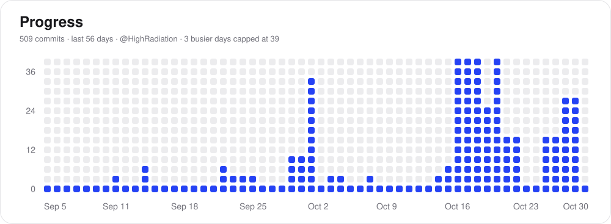

  
  
  
  

<picture>
  <source media="(prefers-color-scheme: dark)" srcset="assets/progress-dark.svg">
  
</picture>

## Projects

- [Azuranous](https://azuranous-app.vercel.app/)
- [Azuranone](https://azuraone.com/)
