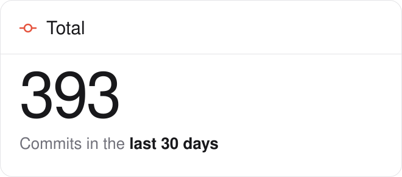
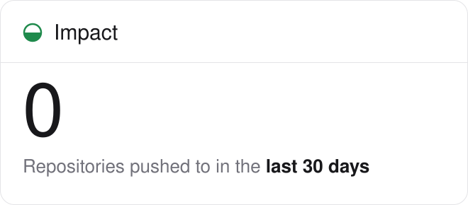
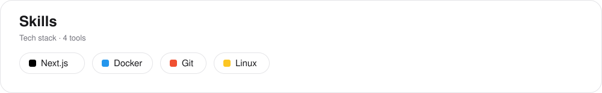
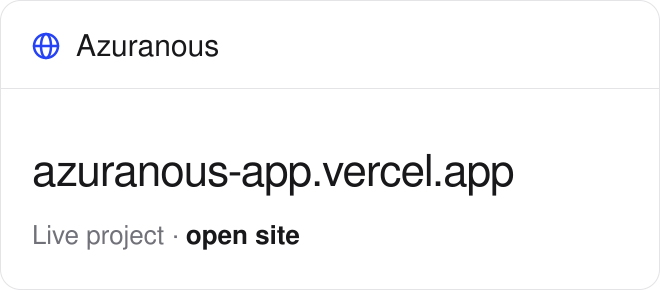
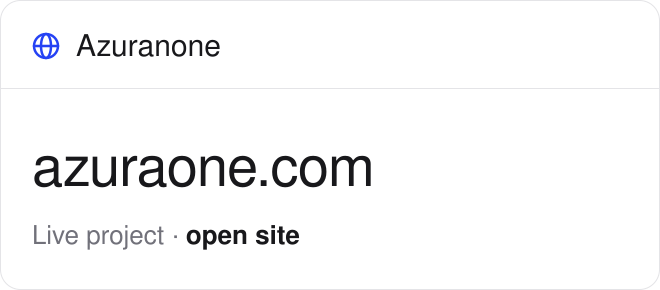

<picture>
  <source media="(prefers-color-scheme: dark)" srcset="assets/progress-dark.svg">
  
</picture>

<picture>
  <source media="(prefers-color-scheme: dark)" srcset="assets/stat-commits-dark.svg">
  
</picture>
<picture>
  <source media="(prefers-color-scheme: dark)" srcset="assets/stat-repos-dark.svg">
  
</picture>

<picture>
  <source media="(prefers-color-scheme: dark)" srcset="assets/skills-dark.svg">
  
</picture>

## Projects

<!-- PROJECTS:START -->
<a href="https://azuranous-app.vercel.app/"><picture><source media="(prefers-color-scheme: dark)" srcset="assets/project-azuranous-dark.svg"></picture></a>
<a href="https://azuraone.com/"><picture><source media="(prefers-color-scheme: dark)" srcset="assets/project-azuranone-dark.svg"></picture></a>
<!-- PROJECTS:END -->
